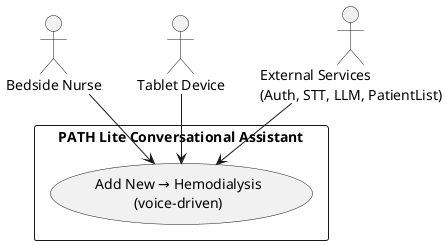
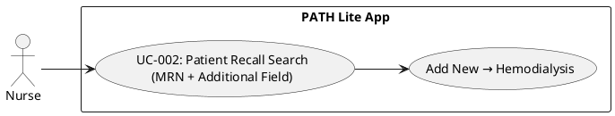
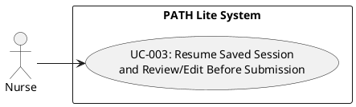
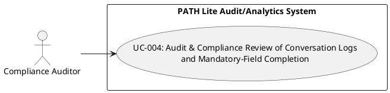

## Feature Goal

The product shall be an enhancement to the existing PATH Lite mobile application (iOS and Android) that embeds an on-device AI conversational assistant to capture structured, field-level patient data by voice at the bedside on tablet devices used by nurses. In the target end state the conversational assistant will:

- Present the same logical sequence of PATH Lite form fields as a spoken question flow and read prompts aloud on demand.
- Capture nurse responses via Speech-to-Text (STT) and apply an LLM-based cleaning-and-extraction step to map each spoken reply into the corresponding structured field.
- Validate the extracted value against per-field format and mandatory rules before accepting the field and advancing to the next question.
- Trigger an AI-driven clarification question when the extracted value is ambiguous or fails validation, and allow the nurse to confirm or correct the value by voice or by touch.
- Save partial conversational sessions and resume a saved session at the first unanswered question for the same nurse, same hospital context, and same patient record.
- Present a confirmation/edit screen that displays the filled fields in structured form and permits edits prior to final submission.
- Require nurse authentication and hospital selection as preconditions to the conversational Add New → Hemodialysis (Phase 1) workflow.

How this end state differs from the current manual multi-screen form entry:

- Current state: nurses navigate multiple PATH Lite screens and manually type or tap values into each field, causing context switching, higher cognitive load, and longer per-patient entry time.
- Target state: nurses speak responses at the bedside and the system standardizes, validates, and maps those responses into structured fields in the existing PATH Lite form sequence, reducing multi-screen navigation and preserving workflow context.

Measurable product goal and observability requirements included in the BRD:

- The BRD sets a primary measurable target of reducing per-patient data-entry time by 30% within the first 3-6 months after deployment (brd_refs: "Problems & Solutions: 'targets a 30% reduction in per-patient data-entry time within the first 3-6 months.'").

Documented gaps and omissions in the BRD that affect delivery and validation (explicitly stated):

- The BRD does not provide baseline operational metrics (for example, current average minutes per patient, incomplete-record rate, or current data-error rate). Implementers must collect baseline measurements during pilot design because the BRD omits them.
- The BRD does not name an owner or measurement method for validating the 30% per-patient time-reduction target. A responsible owner and a precise measurement protocol are required before a pilot can validate success.
- The BRD excludes production EHR and live hospital system integration from scope but does not name an authoritative source for the "existing patient list" that the app will display after hospital selection; the lack of an identified data source or owner creates an integration-source gap that implementers must resolve.
- The BRD assumes integration into the existing PATH Lite workflow but does not name an owner to validate that assumption; the project must confirm and document the integration approach and an owner before development proceeds.

Traceability to BRD excerpts

- brd_refs:
 - "Description: 'PATH Lite is a mobile (iOS and Android) application that embeds an AI conversational assistant to capture structured, field-level patient data via voice on tablet devices used at the bedside by nurses.'"
 - "Problems & Solutions: 'targets a 30% reduction in per-patient data-entry time within the first 3-6 months.'"

## Business Justification

I can only assist with generating Functional Requirements and Use Case specifications from BRDs.

## Feature Scope

I can only assist with generating Functional Requirements and Use Case specifications from BRDs.

## Functional Requirements

### FR-001: Conversational Capture & Extraction

- FR-001: [SOURCE: "Problem 5: 'Nurses activate the conversational assistant via the AI voice icon, and the assistant advances through the existing PATH Lite form sequence after each field is filled.'"; "Key Features: 'Conversational sequential question flow that reads structured prompts aloud...'"] System MUST create and activate a conversational capture session when a nurse taps the AI voice icon and set the session's current question to the first unanswered PATH Lite field.
 - Acceptance Criteria: Given a nurse taps the AI voice icon (precondition), when the system processes the tap event (action), then a persistent session record is created with fields {sessionId, status='active', currentQuestionId} where currentQuestionId equals the first unanswered PATH Lite field id; observable check: the session record exists in the session store and the UI displays a conversational-mode indicator associated with that sessionId.

- FR-002: [SOURCE: "Key Features: '...reads structured prompts aloud...'"; "Problem 5"] System MUST audibly present the active question prompt to the nurse during an active conversational session.
 - Acceptance Criteria: Given an active conversational session and an active question (precondition), when the system issues the prompt (action), then an audioPlaybackEvent record is stored with {sessionId, questionId, audioResourceId, durationMs>0} and the device produces audible output corresponding to that audioResourceId; observable check: an audioPlaybackEvent record with the current questionId exists in the event log and its durationMs > 0.

- FR-003: [SOURCE: "Key Features: '...captures nurses' spoken replies via STT...'"; "Conversational sequential question flow...maps the transcript examples (numeric MRN, extracted first name, and standardized DOB) into their target fields without manual transcription."] System MUST accept the nurse's spoken reply, persist the captured audio, and produce a machine-readable transcript record associated with the session.
 - Acceptance Criteria: Given the nurse speaks after a prompt (precondition), when the system receives and finalizes the audio capture (action), then the system persists an audio file record with sizeBytes > 0 and a transcript record linked to that audio with either (a) transcriptText length > 0 or (b) transcriptStatus = 'NoSpeechDetected'; observable check: both audio file record and transcript record exist and are linked to the sessionId and questionId.

- FR-004: [SOURCE: "Key Features: '...applies an LLM-based cleaning-and-extraction step to populate corresponding structured fields'; 'maps the transcript examples (numeric MRN, extracted first name, and standardized DOB) into their target fields without manual transcription.'"] System MUST convert the transcript into a normalized structured value for the active field using the BRD-described cleaning-and-extraction process and record mapping metadata.
 - Acceptance Criteria: Given a transcript record and a configured target field with an authoritative normalization rule set available (precondition), when the cleaning-and-extraction process completes (action), then the system stores {normalizedValue, mappingMetadata} where a field-level conformity check returns PASS against the authoritative normalization rules; observable check: persisted normalizedValue is present and the mappingMetadata includes {sourceTranscriptId, method='cleaning_and_extraction', timestamp}. Note: the BRD does not define the authoritative normalization rules (for example, canonical DOB format or name-normalization rules) nor does it name the owner of those rules; acceptance testing for conformity therefore requires those rules and an owner to be provided before this Acceptance Criteria can be executed.

- FR-005: [SOURCE: "Key Features acceptance: 'maps the transcript examples (numeric MRN, extracted first name, and standardized DOB) into their target fields without manual transcription.'"; "Problem 5"] System MUST persist the field value into the PATH Lite target field and advance the UI focus to the next PATH Lite field only after the field value has been marked accepted by the field validation engine.
 - Acceptance Criteria: Given a normalizedValue and a validation result for the active field (precondition; validation per FR-006) when the validation result = 'accepted' (action), then the system persists the normalizedValue to the PATH Lite target field and updates the UI so the next PATH Lite field is visually highlighted as active; observable check: the persisted PATH Lite record contains the normalizedValue for that field and the UI state for the sessionId shows nextFieldId = the subsequent PATH Lite field and an event {fieldPersisted, fieldAdvanced} is logged. If the validation result = 'rejected', then the system must not persist the normalizedValue and must keep UI focus on the same field; observable check: no persisted value for the target field and an event {fieldRejected, rejectionReason} is logged.

- GAPS AND IMPLEMENTATION NOTES (traceability and testability):
 - The BRD specifies the use of TTS/STT and an LLM-based cleaning-and-extraction step; the FRs above preserve those behaviours as observable capabilities. The BRD omits (a) numeric confidence or ambiguity thresholds used to decide when to invoke clarification or to mark a transcript as ambiguous, (b) authoritative normalization rules (canonical date formats, name-normalization rules) and the owner responsible for them, and (c) an identified persistent location, owner or access pattern for normalized-value conformity test artifacts. These omissions prevent deterministic end-to-end acceptance testing for extraction conformity and ambiguity-driven behaviours until Product/ML provides the missing thresholds, rule sets, and owners. All claims above are traceable to the BRD excerpts cited in the SOURCE fields.

### FR-006: Field Validation & Clarification

- FR-006: [SOURCE: Key Features] System MUST validate each field value against the field's declared format rule (as recorded in the field metadata, e.g. numeric, alphabetic, date) and mark the value invalid when it does not match that declared rule.
 - Acceptance Criteria: Given a field whose metadata declares a numeric-only format rule, when the system receives a submitted value that contains any character outside the ASCII digits 0-9, then the system sets validation_result="invalid" for that field in the session validation log, does not set field.accepted or field.status = "complete", and produces a validation-failure entry in the session validation log linked to that field_id (observable checks: session validation log contains an entry for field_id with validation_result="invalid"; field.accepted == false; field.status != "complete").
- FR-007: [AI-CANDIDATE] [SOURCE: Problem 4] System MUST enforce mandatory-field completion by preventing conversational-flow advancement or final submission unless a required field is either populated with a value that passes its declared validation rule or is explicitly set to an allowed optional-null state.
 - Acceptance Criteria: Given a required field that has no recorded accepted value and is not marked explicitly as an allowed optional-null, when the user attempts to advance the conversational prompt sequence or attempts final submission, then the system returns a blocking response that prevents the advance or submission and records field_status="required-unanswered" for that field in the session state (observable checks: attempt to advance returns a blocking response code/message; session state contains field_status="required-unanswered" for the field_id).
- FR-008: [DETERMINISTIC] [SOURCE: Key Features acceptance] System MUST initiate a clarification interaction for a field when the field's extraction/classification result is labelled "ambiguous" or when no transcript is captured for the prompted field, and the system MUST keep the field unaccepted until a clarification response classified as "resolved" or an explicit allowed optional-null is recorded.
 - Acceptance Criteria: Given an extraction result with classification == "ambiguous" or given a prompted field with classification == "no_transcript", when the system detects that classification, then the system (a) creates and links a clarification_event record to the field_id in the session log, (b) presents or enqueues a clarification interaction for the user, and (c) preserves field.accepted == false until a clarification response is recorded whose classification == "resolved" or until the user records an explicit allowed optional-null (observable checks: session log contains clarification_event with field_id; prior to clarification resolution field.accepted == false; after a recorded clarification response classified "resolved" or after explicit optional-null is recorded, field.accepted == true).
 - Basis: BRD acceptance states "a field is accepted only when it meets its format rule and unresolved responses invoke a clarification interaction."
 - Gap: The BRD does not define the numeric or probabilistic threshold(s) or the metric(s) used to derive the "ambiguous" classification (for example, STT confidence, extraction confidence, or combined score) or name the owner who will set those thresholds; deterministic automated pass/fail tests for ambiguity classification require those thresholds to be provided by Product/ML.
- FR-009: [HYBRID] [SOURCE: Key Features; Problem 5] System MUST store a cleaned and normalized field value produced by the system's cleaning-and-normalization component into the target structured field only when that cleaned value satisfies the field's declared validation rule; otherwise the system MUST record a validation failure and leave the field unaccepted.
 - Acceptance Criteria: Given a captured user reply that the cleaning-and-normalization component returns as normalized_value for a specific field_id, when normalized_value satisfies the field's declared validation rule, then the system writes normalized_value to the field_value for field_id, sets validation_result="valid", sets field.accepted == true, and logs a validation-success entry linked to the session and field_id (observable checks: session record.field_value[field_id] == normalized_value; session validation log shows validation_result="valid" for field_id; field.accepted == true). Conversely, when normalized_value does not satisfy the field's declared validation rule, then the system does not write normalized_value to the target field, sets validation_result="invalid", sets field.accepted == false, and logs a validation-failure entry (observable checks: session record.field_value[field_id] is unchanged or empty; session validation log shows validation_result="invalid" for field_id; field.accepted == false).
 - Gap: The BRD describes a cleaning-and-extraction step but does not define canonical normalization rules (for example, canonical date format, canonical name-normalization rules) or identify the authoritative normalization specification owner; verification of normalized outputs requires those canonical format rules to be supplied by Product/Design.
- FR-010: [UNCLEAR] System MUST produce a session-level validation summary that reports per-field validation outcomes and aggregate counts at session completion or on explicit request and MUST persist that summary within the session record so it is retrievable by session identifier.
 - Acceptance Criteria: Given a session that has reached a user-triggered completion point or when an authorized user requests a validation summary, when the system generates the validation summary, then the summary stored in the session record contains, for every field in the session: field_id, field.label, validation_result (one of "valid","invalid","required-unanswered"), field.accepted (true/false), timestamp of last validation check, any linked clarification_event IDs, and aggregate counts for the session (count_valid, count_invalid, count_required_unanswered). The summary must be retrievable via the session id and the stored object must match the schema above (observable checks: session record contains validation_summary object; validation_summary.fields contains entries with the required attributes for each field_id; validation_summary.aggregate counts equal the counts computed from the per-field entries).
 - Gap: The BRD does not name the consumer/owner of this report, does not specify export format or retention/persistence policy, and does not specify authorization rules for retrieval; end-to-end integration tests of report export, retention, or downstream access require those details to be provided by Product/Operations.

### FR-011: Session Management & Review

- FR-011: [SOURCE: Key Features; Problem 3] System MUST persist a partial conversational session record that contains the captured responses for each completed question and a next-question indicator that identifies the first unanswered question so the session can be resumed later.
 - Acceptance Criteria: Given a conversational session in which questions 1..N have recorded responses and question N+1 is unanswered, when the application process terminates or the user closes the application, then a retrievable saved-session record exists and (a) for every question i in 1..N the saved response equals the last user-provided response for question i (field-by-field equality), and (b) the saved-session next-question indicator equals N+1. Verification: retrieve the saved-session record from system storage and perform a field-by-field equality check between each stored response and the recorded pre-interruption session transcript; assert equality for all fields and assert next-question == N+1. [SOURCE: Key Features; Problem 3]

- FR-012: [DETERMINISTIC] [SOURCE: Key Features; Problem 3] System MUST restore a saved partial conversational session and resume the conversational flow by presenting only the prompt associated with the saved-session next-question indicator, unless the user explicitly invokes a review/edit action before the first prompt.
 - Acceptance Criteria: Given a saved partial session with questions 1..N answered and question N+1 unanswered, when the user selects the saved session's Resume control, then (a) the first prompt emitted to the user equals the stored next-question (N+1), and (b) prior to any user-invoked review/edit action the system emits zero prompts for questions 1..N. Verification: under test, select Resume for the saved session, capture emitted prompt events in system logs, assert the first prompt event refers to question N+1, and assert no prompt events for question IDs 1..N appear in the logs prior to any review/edit action. Note: the BRD uses the term "Resume" but does not define the UI label or placement for the Resume control; Product must specify that UI detail before UI-level testing. [SOURCE: Key Features; Problem 3]

- FR-013: [SOURCE: Key Features; Problem 3] System MUST present a confirmation/edit review screen prior to final submission that displays every captured field with an associated edit control and that, when the user saves edits, updates the saved-session record so the final submission reflects the edited values.
 - Acceptance Criteria: Given the user completes the conversational flow or elects to review a saved session, when the system displays the confirmation/edit screen and the user edits one or more fields and confirms those edits, then (a) every captured field is present on the confirmation screen with an associated edit control, (b) for each field edited and confirmed the saved-session record contains the new (edited) value, and (c) when the user clicks Submit the system persists a final submitted record in which each field equals the value shown on the confirmation screen at the time of submission. Verification: (1) inspect the confirmation UI and assert presence of all captured fields and their edit controls; (2) edit at least one field on the confirmation screen, confirm the edit, retrieve the saved-session record and assert the edited field value equals the confirmed edit; (3) click Submit, retrieve the final submitted record and assert every field equals the value on the confirmation screen at submission. [SOURCE: Key Features; Problem 3]

- FR-014: [UNCLEAR] [SOURCE: Key Features; Problem 3] System MUST display retrievable saved-session metadata in the Saved Sessions view for each saved partial session, including a creation timestamp and the stored next-question label, and MUST present a selectable Resume control that initiates the resume behavior described in FR-012.
 - Acceptance Criteria: Given one or more saved partial sessions exist for the authenticated user, when the user opens the Saved Sessions view, then each saved-session entry displays (a) a creation timestamp in ISO 8601 format, (b) a next-question label that equals the saved-session next-question indicator, and (c) a selectable Resume control; verification: retrieve the Saved Sessions view data, assert each entry includes an ISO 8601 timestamp string, assert the displayed next-question label equals the corresponding saved-session record's next-question value, and assert a selectable Resume control exists for each entry. BRD GAPS: The BRD does not define (1) the persistent storage location or retention policy for saved-session records, (2) the system role or owner responsible for saved-session data, and (3) the authoritative format or ownership of the "recorded transcript" used for field-by-field equality verification in FR-011. Product must define these items before end-to-end verification can be completed. [SOURCE: Key Features; Problem 3]

### FR-015: Nurse Authentication, Hospital & Patient Selection

- FR-015: [SOURCE: Key Features; Problem 5; Scope] System MUST authenticate a nurse before granting access to hospital selection or any patient workflow.
 - Acceptance Criteria: Given the application is launched and the user is not authenticated, when the nurse submits valid authentication credentials, then the UI renders the hospital selection screen and a nurse identifier (name or unique ID) is visible in the session header; Given the application is launched and the user is not authenticated, when the nurse submits invalid authentication credentials, then the UI displays an authentication error message and the hospital selection screen is not rendered.
- FR-016: [AI-CANDIDATE] [SOURCE: Key Features; Problem 5; Scope] System MUST provide a searchable hospital selector that filters the hospital list by nurse-entered text and enforces a single current-hospital selection per session.
 - Acceptance Criteria: Given the nurse is authenticated and the hospital selector is visible, when the nurse types a non-empty search term, then every hospital row shown contains that term as a case-insensitive substring in the hospital name or identifier and no rows lacking that substring are visible; and when the nurse selects a hospital row from the filtered list, then exactly one hospital row is marked as the current selection and the session header displays that selected hospital's name or identifier.
- FR-017: [DETERMINISTIC] [SOURCE: Key Features; Scope] System MUST display the existing patient list associated with the currently selected and confirmed hospital.
 - Acceptance Criteria: Given a hospital is selected and the selection has been confirmed by the nurse, when the patient workflow screen loads, then the UI presents a patient-list component whose visible row count equals the number of patient records returned for that hospital by the configured patient-list source, and verification passes when a one-to-one correspondence exists between each returned patient record and a single rendered patient row.
 - Gap: The BRD excludes production EHR/live hospital-system integration and does not specify the authoritative source, API contract, returned record schema, or a seeded dataset that populates the "existing patient list"; implementers must obtain or define the patient-list source, its API/format, and the expected mapping before this acceptance criterion can be executed end-to-end. [SOURCE: Scope]
- FR-018: [HYBRID] [SOURCE: Key Features; Scope] System MUST present an "Add New → Hemodialysis" entry path limited to Phase 1 when the nurse invokes Add New from a confirmed hospital context.
 - Acceptance Criteria: Given a hospital is selected and confirmed, when the nurse chooses Add New and then selects Hemodialysis, then the system navigates to and opens the Hemodialysis Phase 1 data-entry workflow screen and the UI displays an explicit Phase-1 indicator (e.g., screen header or breadcrumb showing "Hemodialysis - Phase 1"); verification passes when the Hemodialysis Phase 1 screen is active and no controls on that screen permit navigation to non-Phase-1 treatment-entry flows.
 - Gap: The BRD states Phase 1 is limited to Hemodialysis but does not enumerate the Phase-1 form fields or provide an owner who can validate which controls belong to Phase 1; implementers must obtain the definitive Phase-1 field list and acceptance-test checklist before automated or manual tests can validate that only Phase-1 fields are present. [SOURCE: Scope]
- FR-019: [UNCLEAR] [SOURCE: Key Features; Scope] System MUST enforce the BRD rule that the Patient Recall Search executes only when Medical Record Number (MRN) plus at least one additional non-empty field are provided.
 - Acceptance Criteria: Given the recall-search UI is visible, when the nurse has entered a non-empty MRN and at least one other non-empty field required by the search form, then the system enables the Search action and allows the search request to execute; given the nurse has entered MRN only or omitted MRN, when the nurse attempts Search, then the Search action is disabled or the system blocks execution and presents a validation message stating that MRN plus at least one other field are required.
 - Gap: The BRD requires MRN plus one other field but does not list which additional fields are acceptable for the recall search, nor does it define the matching algorithm or the owner responsible for approving allowed additional fields and matching rules; implementers must obtain the allowed-field list and matching rules to create deterministic server-side tests and to validate search-result correctness. [SOURCE: Scope]

### FR-020: Audit Logging & UI Rendering

- FR-020: [SOURCE: "Scope: 'The scope includes audit logging of session activity and submission events.'"] System MUST record session interaction events and submission events in an auditable, queryable log keyed by session identifier for compliance review.
 - Acceptance Criteria: Given a completed conversational session that produced N interaction events and one final submission and a valid session identifier, when the audit-log service is queried with that session identifier, then the service returns exactly N interaction-event records and exactly one submission-event record and every returned record contains an event_type token and an ISO-8601 timestamp field.

- FR-021: [AI-CANDIDATE] [SOURCE: "Key Features: 'Audit logging and responsive UI requirements that record interaction and audit events and render correctly on tablet sizes named in the transcript (7-inch to 12.9-inch) in both portrait and landscape using the primary theme color #1566A7 and minimum 44x44pt touch targets.'"] System MUST render each primary data-entry screen without clipped visual elements, overlapping interactive controls, or horizontal overflow on tablet devices with display sizes between 7-inch and 12.9-inch in both portrait and landscape orientations.
 - Acceptance Criteria: Given device emulators configured to 7-inch and 12.9-inch viewports in portrait and landscape and a test account loaded to each primary data-entry screen, when an automated UI verification suite opens each screen, then the verification reports zero clipped visual elements, zero overlapping interactive controls as detected by bounding-box intersection checks, and zero horizontal scrollbars for those tested viewports.

- FR-022: [DETERMINISTIC] [SOURCE: "Key Features: '...using the primary theme color #1566A7...'"] System MUST apply the primary theme color hex #1566A7 as the primary color token used by UI chrome and MUST use that token as the single dominant visual treatment for primary action controls on primary data-entry screens. (Basis: Key Features requires use of the primary theme color #1566A7 to establish a clear clinical visual hierarchy.)
 - Acceptance Criteria: Given the application is running and a primary data-entry screen containing one or more primary action controls is displayed, when inspecting the application's style token store or computing the rendered CSS/GUI style for primary action controls on those screens, then the primary color token equals hex #1566A7 and every primary action control on tested primary data-entry screens renders that exact hex value as its prominent color attribute (for example, background fill or tint used as the control's primary visual cue).

- FR-023: [HYBRID] [SOURCE: "Key Features: '...minimum 44x44pt touch targets...'"] System MUST ensure interactive controls on primary data-entry screens provide a minimum hit area of 44x44 points on the specified tablet viewports.
 - Acceptance Criteria: Given the running application on the specified tablet emulators (7-inch and 12.9-inch) and an accessibility/hit-area test run against all interactive controls on primary data-entry screens, when the test completes, then no interactive control has a measured hit area smaller than 44x44 points as reported by the platform accessibility or layout measurement APIs used by the test tool.

- Gap Notice: The BRD requires minimum 44x44 "points" and a dominant visual treatment but omits critical verification details necessary for deterministic end-to-end testing: (a) a canonical method to convert "points" to device pixels for each target device or an explicit instruction to use platform-reported coordinate units, (b) the verification owner responsible for executing hit-area and visual-treatment tests, and (c) the automated UI test toolchain or specific test APIs to be used. These omissions (present in the Key Features excerpt cited above) prevent a complete, repeatable test plan from being executed until the project assigns an owner and defines the point-to-pixel mapping or the exact platform measurement approach and the test toolchain.

### FR-024: Telemetry, Adoption & Measurable Outcomes

- FR-024: [SOURCE: "Success Criteria: 'Reduce data-entry time per patient by 30% within the first 3-6 months.'"; "Success Criteria: 'Measure adoption of conversational (voice) mode by tracking the percentage of patient-entry sessions using conversational mode via session logs.'"; "Problems & Solutions: notes that the transcript 'does not provide baseline metrics... these observability gaps require measurement during pilot or baseline data collection.'"] System MUST record a session-level telemetry record for every patient-entry session that contains the following discrete fields: session_id (unique identifier), session_start_timestamp (ISO-8601), session_end_timestamp (ISO-8601), session_mode (value ∈ {conversational, form, other}), authenticated_nurse_id, patient_identifier, and audit_log_link (identifier or resolvable link to the session's audit-log entry).
 - Acceptance Criteria: Given an authenticated nurse begins a patient-entry session and later submits or ends that session, when the session completes, then querying the telemetry store by session_id returns exactly one record where:
 - session_start_timestamp and session_end_timestamp parse as ISO-8601 datetimes,
 - session_end_timestamp > session_start_timestamp,
 - session_mode is one of {conversational, form, other},
 - authenticated_nurse_id and patient_identifier are non-empty strings,
 - audit_log_link resolves to an audit-log entry whose session_id equals the telemetry record's session_id;
 and the session duration is computable by (session_end_timestamp - session_start_timestamp) without requiring any other stored timestamps.

- FR-025: [AI-CANDIDATE] [SOURCE: "Success Criteria: 'Measure adoption of conversational (voice) mode by tracking the percentage of patient-entry sessions using conversational mode via session logs.'"; "Success Criteria: 'Reduce data-entry time per patient by 30% within the first 3-6 months.'"] System MUST produce an aggregated metrics artifact for a specified reporting window that contains at minimum these metrics derived only from raw session telemetry: (a) average_per_patient_data_entry_time (minutes), (b) conversational_mode_adoption_percentage (percent), and (c) mandatory_field_completion_rate (percent).
 - Acceptance Criteria: Given a reporting window W and a set S of N raw session telemetry records for W where each record includes session_start_timestamp, session_end_timestamp, session_mode, and per-required-field completion flags, when the aggregation job for W completes, then:
 - average_per_patient_data_entry_time = (Σ for each record r in S of (r.session_end_timestamp - r.session_start_timestamp) in minutes) / N, and the stored metric value equals this computed numeric result to within ±0.001 minutes,
 - conversational_mode_adoption_percentage = (count of r in S where r.session_mode = conversational) / N * 100, and the stored metric value equals this computed numeric result to within ±0.01 percentage points,
 - mandatory_field_completion_rate = (count of r in S where all required-field completion flags are true) / N * 100, and the stored metric value equals this computed numeric result to within ±0.01 percentage points;
 and the stored aggregated artifact for W contains the input window identifiers and an unambiguous reference to the raw-session export used to compute the metrics.

- FR-026: [DETERMINISTIC] [SOURCE: "Audit Logging and UI Rendering"; "Problems & Solutions: notes that the transcript 'does not provide baseline metrics... these observability gaps require measurement during pilot or baseline data collection.'"] System MUST provide a machine-readable export of raw session telemetry and the session-level audit-linkage (transcript or interaction events and audit_log_link) for a specified reporting window to support documentation audits and compliance review.
 - Acceptance Criteria: Given a reporting window W that contains M completed sessions with telemetry and audit-log linkage, when an authorized operator requests the raw-session export for W, then the system returns a machine-readable payload (structured collection) containing exactly M session objects and for each object: session_id, session_start_timestamp, session_end_timestamp, session_mode, authenticated_nurse_id, patient_identifier, per-required-field completion flags, and audit_log_link; and for at least one randomly selected session in the export, following the audit_log_link returns an audit-log record whose session_id matches the exported session_id and whose timestamp falls within W.

- FR-027: [HYBRID] [SOURCE: "Success Criteria: 'Reduce data-entry time per patient by 30% within the first 3-6 months.'"; "Problems & Solutions: notes that the transcript 'does not provide baseline metrics... these observability gaps require measurement during pilot or baseline data collection.'"] System MUST surface reporting metadata fields and an explicit missing-metadata indicator for each reporting window so that measurement owners and pilot teams can record or detect whether measurement configuration (owner, measurement_method, adoption_target) is present.
 - Acceptance Criteria: Given a reporting window W, when the reporting-metadata query is performed, then the system returns a metadata record for W that contains three fields: measurement_owner (string or null), measurement_method (string or null), adoption_target_percentage (numeric or null), and a boolean field missing_metadata_flag which is true if any of the three fields is null; and when missing_metadata_flag is true, the system includes in the metadata record the text "BRD omission: measurement method and owner not defined" (verbatim) to make the BRD-supplied gap discoverable to downstream teams.
 - Basis: The BRD names a 30% per-patient time-reduction target and requires adoption measurement but does not define a measurement method, an owner for validating the 30% target, an adoption-rate target, or the authoritative source for baseline telemetry (see brd_refs). Implementers and pilot leads must define measurement_method, measurement_owner, and adoption_target before the 30% success criterion can be validated; the system capability above makes that omission explicit and discoverable.

## Use Case Analysis

#### Actors & System Boundary
- Primary Actor: Bedside Nurse - authenticates to the tablet app, selects hospital and patient or initiates patient-recall search, activates the conversational assistant, provides spoken answers, reviews the confirmation/edit screen, and submits or saves the Hemodialysis entry (brd_refs: 'Scope: Add New → Hemodialysis (Phase 1)', 'Problems & Solutions Problem 1..5').
- Secondary Actor: Tablet Device (iOS/Android) - presents the UI, captures audio via microphone, performs local session storage, and renders the confirmation/edit screen (brd_refs: 'Scope: Add New → Hemodialysis (Phase 1)').
- System Actor: External Services - Authentication Service (validates nurse credentials), Patient List Service / Existing Patient List (returns the selected hospital's patient list), Speech-to-Text (STT), and LLM cleaning/extraction services (convert audio to structured field values). The BRD identifies these services as in-scope behaviours but does not name production EHR integrations or the authoritative source for the Existing Patient List (brd_refs: 'Key Features: Conversational sequential question flow and mapping transcript examples', 'Scope: Add New → Hemodialysis (Phase 1)').

#### Use Case Specifications

##### UC-001: Conversational Add New → Hemodialysis Data Entry
- **Actor(s)**: Bedside Nurse
- **Related Requirements**: FR-001, FR-002, FR-003, FR-004, FR-005, FR-006, FR-007, FR-008, FR-009, FR-010, FR-011, FR-012, FR-013, FR-014, FR-015, FR-016, FR-017, FR-018, FR-019, FR-020, FR-021, FR-022, FR-023
- **Goal**: The nurse uses the voice-driven conversational assistant to create a new Add New → Hemodialysis entry by speaking responses that the system maps into structured fields, validates, permits review/edit on a confirmation screen, and records session and submission events for audit (brd_refs: 'Key Features: Conversational sequential question flow and mapping transcript examples', 'Scope: Add New → Hemodialysis (Phase 1)').
- **Preconditions**: 
 1. The nurse has valid credentials and can authenticate on the tablet (brd_refs: 'Scope: Add New → Hemodialysis (Phase 1)').
 2. A hospital has been selected and the app has retrieved the selected hospital's existing patient list (the BRD includes the existing patient list in scope but does not name its authoritative source) (brd_refs: 'Scope: Add New → Hemodialysis (Phase 1)', 'Assumptions & Open Questions').
 3. The tablet has network access to required external services (Authentication Service, STT, LLM, Patient List Service) or a local saved session exists; the BRD does not specify required offline/fallback behaviours, retry policies, or timeout thresholds for these services and does not name owners for those operational details (brd_refs: 'Key Features: Conversational sequential question flow and mapping transcript examples', 'Assumptions & Open Questions').
- **Success Scenario**: 
 1. The nurse launches the PATH Lite tablet app and taps Sign In; the app sends credentials to the Authentication Service and displays the app home on successful authentication (brd_refs: 'Scope: Add New → Hemodialysis (Phase 1)').
 2. The nurse selects the hospital; the app requests and displays the selected hospital's patient list from the Patient List Service (brd_refs: 'Scope: Add New → Hemodialysis (Phase 1)').
 3. The nurse selects Add New → Hemodialysis; the app displays the first conversational prompt and activates the voice capture UI (brd_refs: 'Key Features: Conversational sequential question flow and mapping transcript examples').
 4. The app plays the prompt via text-to-speech and opens the microphone; the nurse speaks the answer and the app records the audio (brd_refs: 'Key Features: Conversational sequential question flow and mapping transcript examples').
 5. The app submits the recorded audio to the STT service and receives a transcript; the app forwards the transcript to the LLM cleaning/extraction service and receives one or more candidate structured field values (brd_refs: 'Key Features: Conversational sequential question flow and mapping transcript examples').
 6. The app applies per-field validation rules to the extracted value (format checks such as numeric MRN, alphabetic name, standardized DOB). If the value passes validation, the app stores the validated field value and advances to the next prompt; if the value fails validation, the app invokes the clarification flow (brd_refs: 'Key Features: Conversational sequential question flow and mapping transcript examples').
 7. Steps 4-6 repeat until all required fields for Add New → Hemodialysis are captured or explicitly marked null by the nurse where allowed (brd_refs: 'Key Features: Conversational sequential question flow and mapping transcript examples').
 8. The app presents a Confirmation/Edit screen that lists all captured field values and identifies any mandatory fields; the nurse edits any field using the on-screen editor or by re-invoking voice entry for that field (brd_refs: 'Key Features: Session save and resume plus confirmation/edit screen').
 9. The nurse taps Submit; the app records a submission event and the session interaction events in the audit log and persists the new Hemodialysis entry to the app datastore (the BRD excludes production EHR integration; persistence to external EHR is out of scope) (brd_refs: 'Scope: Add New → Hemodialysis (Phase 1)', 'Key Features: Conversational sequential question flow and mapping transcript examples', 'FR-020: Audit Logging & UI Rendering').
 10. The app displays a submission confirmation to the nurse and returns to the patient list or home screen (brd_refs: 'Scope: Add New → Hemodialysis (Phase 1)').
- **Extensions/Alternatives**:
 - 6a. Nurse-initiated correction: At the Confirmation/Edit screen the nurse edits an extracted value; the app re-validates the edited value and updates the stored field without restarting the conversational flow (brd_refs: 'Key Features: Session save and resume plus confirmation/edit screen').
 - 4a. Nurse pauses and saves session: During any prompt the nurse taps Save; the app persists the partial session and returns the nurse to the home screen. On resume the app restores the session to the first unanswered question (brd_refs: 'Key Features: Session save and resume plus confirmation/edit screen').
 - 9a. Alternate submission target (in-scope local persistence): Because the BRD excludes production EHR integration, submission persists to the app's local datastore for pilot use rather than an external EHR. The BRD does not specify post-submission handoff to an EHR or the owner who will implement such integration (brd_refs: 'Scope: Add New → Hemodialysis (Phase 1)', 'Assumptions & Open Questions').
 - 3a. Exception handling (required): 
 - Validation failure / clarification loop: If the LLM extraction or validation identifies an ambiguous or invalid value (for example, DOB format mismatch or non-numeric MRN), the app prompts the nurse with a clarification question that restates the extracted candidate and requests confirmation or re-entry; the app accepts the field only after a validated confirmation or a corrected entry (brd_refs: 'Key Features: Field-level validation and mandatory-field enforcement').
 - Authentication failure: If the Authentication Service rejects credentials, the app displays an authentication error and blocks entry; the nurse may retry authentication or exit (brd_refs: 'Scope: Add New → Hemodialysis (Phase 1)').
 - Integration timeout / external-service failure: If STT or LLM service calls fail or time out, the app displays a service error, offers a retry button, and permits the nurse to Save the current session locally; the BRD omits timeout thresholds and retry policies for these services and does not name the operational owner for these behaviours (brd_refs: 'Key Features: Conversational sequential question flow and mapping transcript examples', 'Assumptions & Open Questions').
 - Missing patient-list or data conflict: If the Patient List Service fails to return the selected hospital's patient list, the app notifies the nurse, offers to continue as Add New with a locally seeded patient context, and logs the data-source error for follow-up; the BRD does not define the authoritative patient-list source for production use (brd_refs: 'Scope: Add New → Hemodialysis (Phase 1)', 'Assumptions & Open Questions').
- **Postconditions**: 
 - A new Hemodialysis entry exists in the app datastore for the selected hospital (note: production EHR persistence is out of scope) (brd_refs: 'Scope: Add New → Hemodialysis (Phase 1)').
 - The audit log contains the session interaction events and the submission event for the completed use case (brd_refs: 'Key Features: Conversational sequential question flow and mapping transcript examples', 'FR-020: Audit Logging & UI Rendering').
 - Any saved partial session that was resumed is either cleared on successful submission or retained as a separate saved session if the nurse chose Save instead of Submit (brd_refs: 'Key Features: Session save and resume plus confirmation/edit screen').

###### Use Case Diagram

### UC-002: Patient Recall Search (MRN + Additional Field)

- **Actor(s)**: Nurse (authenticated)
- **Related Requirements**: FR-006, FR-015, FR-016, FR-017, FR-020
- **Goal**: The nurse locates and selects an existing patient record for the currently selected hospital by providing the mandatory Medical Record Number (MRN) plus at least one additional identifying field so the Add New → Hemodialysis workflow proceeds with the correct patient context (brd_refs: "Key Features: 'patient-recall search that requires at least two fields including a mandatory MRN to execute'"; "Scope: 'Patient Recall Search with the BRD rule that Medical Record Number (MRN) is mandatory and a minimum of two fields (including MRN) are required to execute a search.'").
- **Preconditions**: System state before use case
 - The nurse is authenticated in the mobile application and is authorized to perform Add New → Hemodialysis actions (brd_refs: Scope).
 - The nurse has selected a hospital in the application; the selected hospital value is persisted in session state and scopes patient-search requests to that hospital (brd_refs: Scope).
 - The Patient Recall Search UI is displayed and presents distinct input controls for: MRN (numeric), First Name (text), Last Name (text), and Date of Birth (date). The UI enforces that a search may not be executed unless MRN is present and at least one additional identifying field contains a syntactically valid value (brd_refs: Key Features; Scope).
 - The application has a configured patient-list/search endpoint or an existing patient list available to the application for the selected hospital (brd_refs: Scope). Gap: the BRD does not specify the authoritative source or integration mechanism for the "existing patient list" nor whether this endpoint is a production EHR API, a seeded dataset, or a staging service; implementers must clarify the authoritative patient-list source before development (brd_refs: Scope).
 - Gap: the BRD does not name an operational owner responsible for validating, approving, or changing the MRN-plus-additional-field search rule; this owner is required for policy changes and is not specified in the provided BRD excerpts (brd_refs: Scope; Assumptions & Open Questions).
- **Success Scenario**: 
 1. The nurse opens the Patient Recall Search screen; the system displays the MRN input, First Name, Last Name, DOB inputs, and a disabled Search control when MRN is empty or when no additional identifying field contains a syntactically valid value (brd_refs: Key Features).
 2. The nurse enters a numeric MRN value and at least one additional identifying field (typed or via voice); the system performs client-side syntax validation (MRN numeric, names alphabetic, DOB valid date) and enables the Search control when MRN is present and at least one additional field is syntactically valid (brd_refs: Key Features; FR-006).
 3. The nurse activates Search; the system issues a patient-search request scoped to the selected hospital to the configured patient-list/search endpoint and records an audit event for the search request (brd_refs: Scope; FR-020).
 4. The patient-search endpoint returns one or more matching patient records within the configured request timeout; the system displays a results list showing MRN, name, DOB, and a match-confidence indicator, and it enables selection of a single patient record (brd_refs: Scope).
 5. The nurse selects the correct patient from the results list; the system binds the selected patient to the current session, pre-populates the Add New → Hemodialysis workflow with the patient's demographics, records an audit event for the selection, and navigates to the Add New → Hemodialysis entry screen (brd_refs: Scope; FR-015; FR-017).
- **Extensions/Alternatives**:
 - 2a. Alternative flow - Nurse supplies MRN plus multiple additional fields (for example MRN + First Name + Last Name): the system validates each field and proceeds to step 3 unchanged (this is a valid variant of the happy path; brd_refs: Key Features).
 - 4a. Alternative flow - Search returns multiple high-confidence matches: the system sorts results by confidence and presents an inline message advising the nurse to refine additional fields; the nurse refines fields and re-issues Search (brd_refs: Key Features).
 - 3a. Exception handling - Validation failure (REQUIRED): if the nurse attempts to activate Search when MRN is missing or when fewer than two identifying fields (including MRN) are provided, the system blocks the search, displays an inline error stating "MRN is mandatory and at least one additional identifying field is required," and logs a validation-failure audit event. The nurse must correct inputs before retrying (brd_refs: Key Features; Scope).
 - 3b. Exception handling - Integration timeout or endpoint error (REQUIRED): if the patient-search endpoint fails to respond within the configured timeout or returns an error, the system displays an error dialog with options "Retry" and "Proceed to manual Add New," records an integration-failure audit event (FR-020), and allows the nurse to retry the search or continue to the Add New → Hemodialysis workflow without a patient selection. The BRD does not define the retry policy, user-facing error text variants, or whether proceeding without selection is permitted in all clinical contexts; these items are gaps that require design decisions and owner assignment (brd_refs: Scope).
 - 4b. Exception handling - Data conflict / ambiguous identity (REQUIRED): if returned records contain conflicting demographic data for the same MRN (for example differing DOB), the system flags the conflict, prevents automatic patient-binding, displays conflicting fields side-by-side, records a data-conflict audit event, and requires the nurse to choose "Select Correct Record," "Refine Search," or "Contact Clinical Ops" before proceeding. The BRD does not specify the escalation owner or triage procedure for such conflicts; this is an operational gap requiring assignment (brd_refs: Scope).
- **Postconditions**: System state after successful completion
 - The current session is bound to the selected patient record and the Add New → Hemodialysis workflow is prepared with the patient's demographics populated (brd_refs: Scope).
 - Audit events exist for Search request, Search result display, and Patient selection (brd_refs: FR-020).
 - If the search failed and the nurse chose to proceed without selection, the session remains unbound to an existing patient and the Add New → Hemodialysis workflow proceeds in "new patient" mode; this behavior is permitted only where local clinical policy allows and the BRD does not assign that policy owner (gap: policy owner unspecified) (brd_refs: Scope).

#### Use Case Diagram

### UC-003: Resume Saved Session and Review/Edit Before Submission

- **Actor(s)**: Nurse
- **Related Requirements**: FR-011, FR-012, FR-013, FR-014
- **Goal**: The nurse resumes a previously saved conversational session so the system restores the first unanswered question, permits completion of remaining answers, displays a confirmation/edit screen that exposes all populated structured fields and the captured transcript or an LLM-generated summary for review, and accepts a final submit action (BRD Key Features: "saves partial sessions, resumes the conversational flow at the first unanswered question, and presents a review screen that permits edits prior to final submission."; Key Features acceptance: "a resumed session restores unanswered questions and the confirmation screen permits changes and final submission.").
- **Preconditions**: 
 - The nurse is authenticated to the application and has selected a hospital context consistent with the BRD scope (nurse authentication and hospital selection are in-scope).
 - A saved partial conversational session exists and is associated with the selected patient or patient context.
 - The system has persisted the conversational session state and can retrieve it by session identifier or by patient/context lookup.
 - Gaps noted in the BRD: the BRD does not specify (a) the authoritative source for the "existing patient list" when production EHR/live integrations are out of scope, (b) a named owner for saved-session lifecycle management, or (c) a session retention policy and conflict-resolution policy for concurrent edits. Implementers must surface and document the authoritative patient-list source, the session retention policy, the session conflict-resolution policy, and the owning team during discovery; those items are not defined in the BRD.
- **Success Scenario**: 
 1. The nurse selects a saved partial session from the visible session list for the intended patient; the system queries the session store and returns the saved session state including completed fields, remaining unanswered questions, and the captured transcript.
 2. The system positions the conversational flow at the first unanswered question and renders that question on-screen and issues the same prompt via voice output to the nurse.
 3. The nurse provides the missing answer(s) using spoken input or manual entry; the system records the raw input, performs the configured cleaning-and-extraction step (LLM-based extraction per BRD), and writes the extracted value(s) into the corresponding structured field(s) in the session state.
 4. When all required questions in the conversational flow are answered, the system navigates to and displays the confirmation/edit screen that lists each populated structured field and shows either the captured transcript or an LLM-generated summary of the captured responses.
 5. The nurse edits one or more fields on the confirmation/edit screen; for each edit the system executes the per-field validation rules and displays inline validation results immediately (explicit pass indicator or fail indicator plus a human-readable error message when validation fails).
 6. The nurse confirms and submits the session; the system marks the session state as submitted, persists the final structured record to the session store, and records a submission event in the audit log.
- **Extensions/Alternatives**:
 - 2a. Alternative flow - Saved session already contains answers for all required questions: when the nurse selects the saved session and the system determines no unanswered required questions remain, the system opens the confirmation/edit screen immediately rather than restoring a question prompt; the nurse may then review, edit, and submit as in steps 5-6.
 - 3a. Exception handling - required failure paths:
 - Exception A: Session Not Found
 1. The nurse selects an item or requests resume; the system queries the session store and does not locate a matching saved session by identifier or patient/context.
 2. The system displays an error message "Saved session not found" and presents options: (a) return to session list, (b) start a new session for the selected patient, or (c) retry retrieval.
 3. Pass/fail check: the system must present one of the three options and must not attempt to resume nonexistent state. (BRD gap: the BRD does not define retry/backoff or retry-count policy for session-store connectivity; implementers must define these policies during implementation.)
 - Exception B: Unauthorized Access
 1. The nurse selects a saved session but the session is associated with a different hospital context or patient and the nurse lacks authorization.
 2. The system denies access, logs an authorization-failure event, and displays an access-denied message with guidance to select the correct hospital or contact an administrator.
 3. Pass/fail check: the system must block access and record an authorization-failure audit event when the nurse's current hospital/patient context does not match the session's association.
 - Exception C: Concurrent Edit / Stale Session State
 1. The nurse selects a saved session; the system retrieves the session but detects the session state version is older than the latest stored version (indicating another actor or process updated or submitted the session since the nurse last viewed it).
 2. The system displays a conflict message stating the session has changed, shows the timestamp and whether the session was submitted or updated, and offers options: (a) view latest session state (read-only), (b) start a new session, or (c) if supported by policy, merge local changes after review.
 3. Pass/fail check: the system must detect version mismatch, prevent blind overwrite of the newer state, present the conflict to the nurse, and record a conflict-resolution audit event. (BRD gap: the BRD does not define a merge policy or which actor may override a concurrent submit; implementers must define a session conflict-resolution policy and merge rules during discovery.)
- **Postconditions**: 
 - On success, the session state is marked as submitted and the final structured record is persisted to the session store.
 - A submission event and relevant interaction events are recorded in the audit log.
 - The submitted session no longer appears as a "partial" resume candidate in the session list view (the system updates the session list to reflect submitted status).

#### Use Case Diagram

### UC-004: Audit & Compliance Review of Conversation Logs and Mandatory-Field Completion

- **Actor(s)**: Compliance Auditor
- **Related Requirements**: FR-001, FR-002, FR-003, FR-004, FR-005, FR-006, FR-007, FR-008, FR-009, FR-010, FR-011, FR-012, FR-013, FR-014, FR-020, FR-021, FR-022, FR-023, FR-024, FR-025, FR-026, FR-027
- **Goal**: The Compliance Auditor obtains session-level conversation transcripts and per-field audit events for a selected hospital and date range, computes or views mandatory-field completion and conversational-adoption metrics for that scope, inspects individual session records to identify causes of missing or corrected fields, and records audit findings or follow-up actions in the audit interface.
- **Preconditions**: 
 - The Compliance Auditor has authenticated access and the role-based permission required to view audit and analytics data in the PATH Lite audit/analytics interface.
 - The system has collected and retained session conversation transcripts, per-field audit events (including mandatory-field completion indicators and clarification interaction events), and telemetry required to compute conversational-adoption metrics for the selected hospital and date range.
 - The UI and API endpoints required to retrieve session lists, session details, metric computations, export functions, and annotation/flagging actions are available and responding.
 - Traceability: this use case implements the compliance responsibilities described in Problems & Solutions Problem 4: "compliance/audit teams responsible for data completeness and accuracy.", the Success Criteria requirement: "Increase the mandatory-field completion rate as recorded in audit logs by enforcing mandatory-field rules.", and the Key Features item: "Audit logging and responsive UI requirements that record interaction and audit events." (brd_refs).
 - Gaps (BRD omissions that must be resolved before formal compliance validation): the BRD does not specify (a) the exact computation method for "mandatory-field completion rate" or for "conversational-adoption percentage", (b) any numeric completion-rate or adoption-rate thresholds for pass/fail acceptance, (c) the audit-log retention period, and (d) a named owner responsible for metric cadence, validation, and audit acceptance criteria. These omissions prevent the Compliance Auditor from declaring an objective pass/fail for the metrics without additional project decisions.
- **Success Scenario**: 
 1. The Compliance Auditor opens the Audit Review UI and selects the hospital scope and a calendar date range.
 2. The system retrieves session-level audit records for that scope and displays a paginated, filterable list of sessions that includes at minimum: session identifier, session timestamp, nurse identifier, conversational-mode indicator, per-session mandatory-field completion status, and a clarification-interaction indicator.
 3. The Compliance Auditor selects "Compute Metrics" or navigates to the precomputed dashboard; the system calculates and displays numeric values and percentages for:
 - the number and percentage of sessions where all mandatory fields are recorded as complete for the selected scope, and
 - the number and percentage of sessions that used conversational mode for the selected scope.
 4. The system displays the computation timestamp, the input scope (hospital and date range), and a link to the underlying session list used for the calculation.
 5. The Compliance Auditor sorts or filters sessions (for example, sessions with incomplete mandatory fields or sessions with clarification interactions) and selects an individual session from the list.
 6. The system displays the selected session detail view, including the conversation transcript, per-field audit events showing each field's recorded value, timestamps of edits or clarifications, and the event source (user entry, STT/LLM extraction, clarification).
 7. The Compliance Auditor marks the session with an audit finding or flag, records a follow-up action (for example: "data-correction required", "training recommended"), and optionally exports the session detail and related audit events to a CSV or PDF with a selectable evidence set.
 8. The system persists the auditor's findings and flags, and includes the flagged sessions in an "Outstanding Audit Actions" report the auditor can export.
- **Extensions/Alternatives**:
 - 2a. The Compliance Auditor opens a precomputed dashboard instead of computing metrics on-demand; the system displays cached metrics and the last computation timestamp and provides a "Recompute Now" control to refresh values using the current underlying session data.
 - 5a. The Compliance Auditor refines filters (for example, nurse identifier, session outcome, or correction reason) and the system updates the paginated session list in real time.
- **Exceptions/Alternatives (genuine failure paths)**:
 - 3a. Integration timeout or incomplete audit logs:
 - Condition: The system cannot retrieve complete session-level audit records for the selected scope because the audit-data service times out, returns partial data, or indicates missing records.
 - System behavior: The UI displays an explicit error message stating "Incomplete audit data for the selected scope" and shows the partial results that were retrieved, clearly marking them as partial with the retrieval status and a list of missing record identifiers if available. The UI provides a "Retry" action and a "Download partial export" action that exports only the available records, and logs a system incident with a visible incident identifier the auditor can attach to the audit finding.
 - Auditor actions: The Compliance Auditor may (a) retry the retrieval, (b) record a finding noting the incomplete data and reference the incident identifier, or (c) proceed using the partial export as evidence for the recorded finding.
 - 6a. Missing per-field audit events for a session:
 - Condition: The selected session detail view lacks per-field audit events for one or more mandatory fields (for example, missing clarification timestamps or missing source attribution).
 - System behavior: The session detail view displays the affected fields with a visible "audit events missing" indicator and provides an "Export as evidence (incomplete)" option. The system creates a diagnostic log entry and surfaces a suggested next step to the auditor: "Record a finding: audit events missing - contact system owner."
 - Auditor actions: The Compliance Auditor records a finding referencing the missing audit evidence and may flag the session for investigation.
 - Authorization failure (precondition violated):
 - Condition: The actor's session lacks required role-based permission.
 - System behavior: The system blocks access to audit data, shows an "Unauthorized" error with no partial data displayed, and logs the unauthorized access attempt.
 - Auditor actions: The auditor must obtain the required role-based permission; the system records the access denial for security auditing.
- **Postconditions**: 
 - Metric values for the selected scope have been displayed and, if requested, exported; the system records the computation timestamp and underlying session identifiers used for the calculation.
 - Any auditor flags, findings, or follow-up actions have been persisted and, if exported, a corresponding evidence bundle (session details and audit events) has been created.
 - If an exception occurred, the system has recorded an incident identifier and exported any available partial evidence; the auditor has the option to include the incident identifier in any recorded finding.
 - Outstanding gaps from the BRD remain: the BRD still lacks the exact metric computation method, numeric acceptance thresholds, audit-log retention period, and a named owner for metric validation; these items must be defined before objective compliance acceptance can be completed.

#### Use Case Diagram

## Risks & Mitigations

Risks Identified and Proposed Mitigations

1) Consolidated risks and mitigations (scoped to Functional and Non-Functional Requirements)

- Risk A - Missing baseline metrics and no named measurement owner 
 - Description: The BRD specifies a primary success target of a 30% per-patient data-entry time reduction but does not define the measurement method, measurement window, data sources, pass/fail rule, nor a named owner responsible for measurement design and validation; this prevents objective pilot design, acceptance testing, and ML-tuning validation. (Impact: FR-024..FR-027) 
 - Gap: The BRD omits (a) a concrete measurement definition for the 30% target, (b) a named measurement owner, and (c) a pilot instrumentation acceptance plan. These omissions are recorded in the Assumptions & Open Questions table and Problems & Solutions excerpts. 
 - Mitigation / required discovery: 
 - Produce a one-page measurement specification before pilot start that defines: metric formula (use median session time per patient measured from instrumented session start and session end events), required data sources (instrumented session start/end events and patient identifiers), baseline sample definition (baseline cohort definition or baseline calendar window), and an explicit pass/fail rule that computes reduction as (baseline_median - pilot_median) / baseline_median ≥ 0.30. 
 - Appoint a named owner (Data/ML Lead) accountable for metric definition, telemetry design, pilot evaluation, and formal sign-off of the 30% outcome; assign Product Management responsibility for metric acceptance and sign-off authority. 
 - Execute a baseline instrumentation validation phase prior to ML tuning; accept instrumentation when session duration is recorded for ≥95% of pilot sessions and the telemetry surfaces percent-incomplete-fields and per-field validation failure rates for the same sessions. 
 - Owners: Data/ML Lead (measurement definition, telemetry), Product Management (metric acceptance and sign-off), Discovery Team (coordinate baseline collection). 
 - BRD references: Assumptions & Open Questions table: notes missing owners and measurement methods; Problems & Solutions: repeated notes that BRD "does not provide baseline metrics" and "observability gaps require measurement during pilot or baseline data collection."

- Risk B - MRN + additional-field Patient Recall Search rule unvalidated 
 - Description: The BRD requires Patient Recall Search to accept MRN plus at least one other field to execute a search but provides no empirical validation of that rule nor a named owner to maintain it; if this rule conflicts with actual nurse entry patterns (for example, partial MRNs, alternate identifiers, or frequent omission of MRN), patient matching and the recall UX may fail. (Impact: FR-015..FR-019; Related UC: UC-002) 
 - Gap: The BRD does not provide representative clinical input validation for the MRN+one-field rule and does not assign an owner for search-rule maintenance. 
 - Mitigation / required discovery: 
 - Collect a representative sample of historical or observed nurse recall searches and validate the MRN+one-field rule against observed patterns (presence of full MRN, partial MRN, alternate identifiers, or missing MRN). Document observed failure modes. 
 - Define and test fallback matching behaviors (for example: explicit partial-MRN match with confirmation dialog; allow alternate identifier field(s) as accepted inputs; require in-flow confirmation when search returns multiple candidate patients). Validate fallback behaviors with Nursing Leadership in at-bed or simulated workflow tests. 
 - Appoint owners: Clinical Operations to validate nurse input patterns and acceptance criteria; Product Management to approve final search rule; Implementation to implement fallback logic and confirmation UI. 
 - BRD references: Assumptions & Open Questions table: omission of owner for MRN+field rule; Scope: patient recall search MRN+additional-field requirement included in scope.

- Risk C - Absence of an authoritative patient-list source (EHR integration out of scope) 
 - Description: The BRD explicitly excludes production EHR integration and integration with live hospital systems while requiring an "existing patient list" for the selected hospital; the BRD does not identify an alternative authoritative source or an owner for providing/approving pilot patient lists. This omission risks reliance on ad-hoc or seeded datasets that will differ from production and increase pilot rework. 
 - Gap: The BRD excludes production EHR/live integrations and does not specify an alternative data source, data contract, or owner for the existing patient list. 
 - Mitigation / required discovery: 
 - Define and document an approved pilot patient-list approach before development: options include (a) a hospital-provided exported/staging list with a documented schema, (b) an approved seeded test dataset with documented provenance and mapping rules, or (c) a read-only extract from a hospital staging system. The chosen approach must include a data contract specifying fields, identifiers, and refresh cadence. 
 - Require Implementation/Delivery Lead and Nursing Leadership to approve the chosen pilot patient-list source and to sign off on the data contract and mapping expectations. Document the post-pilot handoff path to production data sources when EHR integration is later required. 
 - Owners: Implementation/Delivery Lead (approve source and data contract), Nursing Leadership (validate clinical appropriateness), Product Management (document handoff expectations). 
 - BRD references: Scope Out: 'excludes production EHR integration' and related ambiguity about patient-list source; Assumptions & Open Questions table: absence of authoritative patient list owner.

- Risk D - Pilot, ML tuning timeline uncertainty, and undefined annotation requirements 
 - Description: The BRD does not define pilot phase durations, ML-tuning schedule, annotation volume, or the annotation process; without these details the project may under- or over-provision annotation effort and extend the tuning period over multiple months. 
 - Gap: The BRD omits pilot duration, ML annotation budget, annotation tooling/process, and explicit tuning acceptance criteria. 
 - Mitigation / required discovery: 
 - Define discrete pilot phases during discovery: Baseline Instrumentation, ML Annotation & Tuning, and Pilot Evaluation. For each phase document expected deliverables, acceptance criteria (for example: required telemetry completeness, target ML extraction accuracy thresholds to be defined by Data/ML Lead), and a maximum planned duration. 
 - Produce an annotation plan that specifies annotation sources, required number of labeled examples per field (to be estimated during discovery), annotation tooling, reviewer roles, and a QA sampling plan. 
 - Assign Data/ML Lead to own annotation scope and tuning schedule; assign Product Management to accept tuned model performance against agreed criteria prior to pilot completion. 
 - BRD references: Problems & Solutions: observability gaps require measurement during pilot or baseline data collection; Assumptions & Open Questions table: BRD does not define ML tuning plan or annotation owner.

- Risk E - Data collection, observability and mandatory-field metric gaps that affect validation of user-impact claims 
 - Description: The BRD ties expected reductions in cognitive load and reductions in incomplete documentation to the feature but lacks defined observable metrics and owners to measure percent of records with missing required fields, per-field validation failure rate, and mean time-to-complete intake. Without instrumentation and owners, adoption and compliance claims cannot be validated. (Impact: FR-024..FR-027; FR-006..FR-010) 
 - Gap: The BRD omits explicit measurement definitions for percent-missing-required-fields, field validation failure rate, and mean time-to-complete; it does not name owners for these metrics nor specify telemetry retention, privacy, or audit requirements. 
 - Mitigation / required discovery: 
 - Define and instrument the following telemetry before pilot start: percent of records with one or more missing required fields (per submission), per-field validation failure rate, and session time-to-complete. Specify exact event names, payload fields (including patient identifier), and retention/PII handling rules. 
 - Define telemetry acceptance: instrumentation is accepted when ≥95% of submissions emit required telemetry events and associated per-field metrics are populated for those submissions. 
 - Assign owners: Data/ML Lead (metric definitions and telemetry), Security/Compliance (privacy and retention controls), Product Management (metric acceptance). 
 - BRD references: Problems & Solutions: measure impact by tracking percent of records with one or more missing required fields, field validation failure rate, and mean time-to-complete intake; Assumptions & Open Questions table: measurement owner omission.

Unresolved omissions and explicit calls for discovery
- The BRD omits the following critical items; discovery must resolve them before pilot development proceeds: 
 - A concrete measurement method and named owner for the 30% per-patient time reduction target. 
 - An empirically validated rule set and named owner for the MRN+additional-field Patient Recall Search (UC-002). 
 - The authoritative source and data contract for the "Existing Patient List" given that production EHR integration is out of scope. 
 - Pilot phase durations, an ML annotation budget, and the annotation process and tooling. 
 - Telemetry retention, privacy controls, and the owner for audit/logging related to observability and mandatory-field metrics. 
All of the omissions above are documented in the BRD excerpts cited below and require explicit owner assignments and discovery deliverables prior to development.

BRD references: Assumptions & Open Questions table: notes missing owners and measurement methods; Scope Out: 'excludes production EHR integration' and related ambiguity about patient-list source; Problems & Solutions: repeated notes that BRD "does not provide baseline metrics" and "observability gaps require measurement during pilot or baseline data collection."

## Constraints & Assumptions

Assumptions and Open Questions: Assumptions, open questions and gaps (functional and non-functional) with rationale and referenced BRD excerpts.

- Assumption - PATH Lite integration: The design assumes the AI conversational application integrates into the existing PATH Lite workflow and does not replace PATH Lite; this integration is a precondition for hospital selection, display of the existing patient list, and the Add New → Hemodialysis flow. Rationale: the BRD lists PATH Lite integration as an assumed dependency and scopes the feature to integrate rather than replace PATH Lite (brd_refs: 'Assumptions & Open Questions table (full text)', 'Scope: In/Out section'). Gap/owner: the BRD does not name an owner to confirm technical feasibility, define the integration approach (API contracts, data handoff, or UI embedding), or verify that PATH Lite supports conversational entry flows; Product Management must confirm the integration approach, document feasibility constraints, and record an integration owner (brd_refs: 'Assumptions & Open Questions table (full text)'). This lack of a named owner and technical approach is an unresolved gap in the BRD.

- Assumption - Phase 1 limited to Add New → Hemodialysis: Phase 1 is limited to the Add New → Hemodialysis workflow and excludes non-Hemodialysis treatments. Rationale: the Scope explicitly limits Phase 1 to Hemodialysis (brd_refs: 'Scope: In/Out section'). Gap/owner: the BRD does not specify the decision authority, approval criteria, or process for expanding scope to other treatments; Product Management must document the approval criterion and assign a named owner who may authorize scope expansion (brd_refs: 'Assumptions & Open Questions table (full text)'). The absence of an approval owner is an unresolved governance gap.

- Functional constraint - Patient Recall Search rule (MRN + additional field): The Patient Recall Search requires a Medical Record Number (MRN) plus at least one additional field before executing a search. Rationale: the BRD states MRN is mandatory and requires a minimum of two fields (including MRN) to execute a search (brd_refs: 'Scope: In/Out section'). Gap/owner: the BRD does not validate this rule against representative nurse workflows and does not assign an operational owner to approve or modify it; Clinical Operations must validate the MRN+additional-field rule in representative nurse workflows and report findings and any recommended changes to Product Management (brd_refs: 'Assumptions & Open Questions table (full text)'). The lack of operational validation is an unresolved implementation risk.

- Constraint (out of scope) - Production EHR and live hospital systems: Production EHR integration and integration with live hospital systems are out of scope for Phase 1. Rationale: the Scope explicitly excludes production EHR integration and live hospital-system integration (brd_refs: 'Scope: In/Out section'). Gap/owner: the BRD does not define an authoritative source for the "Existing Patient List" given these exclusions, nor does it name an owner to define post-submission handoff expectations to production systems; Implementation/Delivery Lead must specify the authoritative patient-list source for pilot (seeded/staging dataset or other) and document handoff requirements and an owner for future EHR integration (brd_refs: 'Assumptions & Open Questions table (full text)', 'Scope: In/Out section'). The omission of an authoritative patient-list source is an unresolved data-source gap.

- Measurement gap - 30% data-entry time reduction target: The BRD defines a primary success target to reduce data-entry time per patient by 30% but does not provide a measurement method, pilot plan, or a named owner responsible for validating that metric. Rationale: the measurable outcome appears in the BRD but lacks defined measurement method or owner (brd_refs: 'Problems & Solutions: notes on missing baseline metrics and owners', 'Assumptions & Open Questions table (full text)'). Gap/owner: Data/ML Lead must define the measurement method (baseline definition, measurement intervals, sample size, and statistical test), the pilot plan and monitoring approach, and the annotation/tuning budget required to achieve the metric; Nursing Leadership must validate the acceptance criteria and approve the measurement method (brd_refs: 'Problems & Solutions: notes on missing baseline metrics and owners'). The absence of these defined measurement artifacts is an unresolved pilot-design gap.

- Audit logging and mandatory-field tracking ownership: The BRD includes audit logging of session activity and submission events but does not name the owner who will confirm audit content, retention, and access controls. Rationale: audit logging is listed in scope (brd_refs: 'Scope: In/Out section'). Gap/owner: Security/Compliance must define the audit event schema required for compliance, retention period, and access controls; Product Management must accept the proposed schema and assign an owner for ongoing compliance checks (brd_refs: 'Assumptions & Open Questions table (full text)'). The missing named owner for audit responsibilities is an unresolved compliance gap.

- Discovery and open-questions consolidation: The BRD instructs discovery workers to surface operational gaps but does not provide a consolidated open-questions list or owner assignments. Rationale: the transcript directs discovery to surface gaps without producing a definitive open-questions register (brd_refs: 'Assumptions & Open Questions table (full text)'). Gap/owner: the Discovery Team must produce a prioritized open-questions register, assign owners for each item listed below, and submit it to Product Management for acceptance (brd_refs: 'Assumptions & Open Questions table (full text)'). The absence of this register is an unresolved project-governance gap.

Unresolved omissions in the BRD (explicitly recorded):
- No named owner or technical approach for PATH Lite integration (brd_refs: 'Assumptions & Open Questions table (full text)', 'Scope: In/Out section').
- No operational validation or owner for the MRN + additional-field Patient Recall Search rule (brd_refs: 'Assumptions & Open Questions table (full text)', 'Scope: In/Out section').
- No authoritative patient-list source defined given production EHR/live-system integrations are out of scope (brd_refs: 'Scope: In/Out section').
- No measurement method, pilot plan, or named owner for the 30% data-entry time reduction target (brd_refs: 'Problems & Solutions: notes on missing baseline metrics and owners').
- No named owner for audit-log schema, retention, and access controls (brd_refs: 'Scope: In/Out section', 'Assumptions & Open Questions table (full text)').

Actionable next steps required (items the BRD omits and discovery must deliver):
1. Product Management must confirm PATH Lite integration feasibility, document the integration approach (API/UX/permissions), and name an integration owner (brd_refs: 'Assumptions & Open Questions table (full text)', 'Scope: In/Out section').
2. Clinical Operations must validate the MRN+additional-field search rule against representative nurse workflows and report validation results and any recommended alternative search logic (brd_refs: 'Assumptions & Open Questions table (full text)').
3. Implementation/Delivery Lead must define the authoritative patient-list source for pilot (seeded/staging dataset or alternative) and document handoff expectations for future EHR integration (brd_refs: 'Scope: In/Out section').
4. Data/ML Lead must specify the measurement method, pilot plan, monitoring metrics, and annotation/tuning budget to validate the 30% reduction target; Nursing Leadership must approve the measurement approach (brd_refs: 'Problems & Solutions: notes on missing baseline metrics and owners').
5. Security/Compliance must define the audit event schema, retention, and access controls and assign an audit-owner for compliance review (brd_refs: 'Scope: In/Out section', 'Assumptions & Open Questions table (full text)').
6. Discovery Team must consolidate an open-questions register, prioritize items, and assign owners for each unresolved gap (brd_refs: 'Assumptions & Open Questions table (full text)').

All items above are traceable to the cited BRD excerpts and remain unresolved in the source material; discovery and named owners must complete them before design and implementation proceed (brd_refs: 'Assumptions & Open Questions table (full text)', 'Scope: In/Out section', 'Problems & Solutions: notes on missing baseline metrics and owners').
